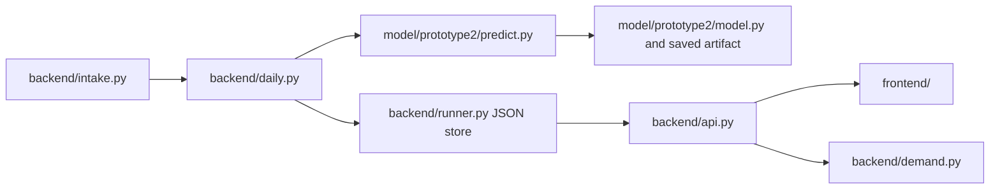

# Local code paths

`backend/runner.py` also has a historical backfill route from
`data/train_test_dataset/`, which was not copied. The active daily route
fetches CIDRAP news and openFDA shortage observations, then calls the saved
Prototype 2 predictor. The FastAPI service exposes the completed local
records and serves `frontend/index.html`, `frontend/live.js`, and
`frontend/public/`.

The archived weekly branch under
`pt1_prototype1_original/legacy_weekly/` originally combined news features,
synthetic risk labels, and synthetic pharmacy demand. Its
`pipeline_original.py` imports modules absent from this copy and expects
omitted research files. `archive/test/` contains standalone diagnostics and
plots. Neither branch is imported by the live API.
